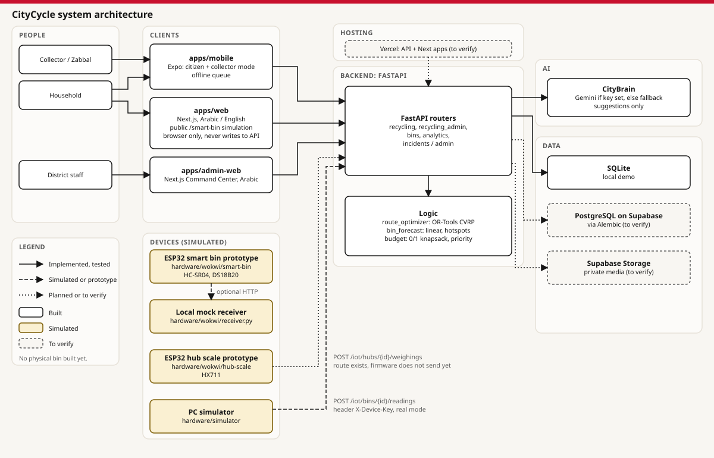
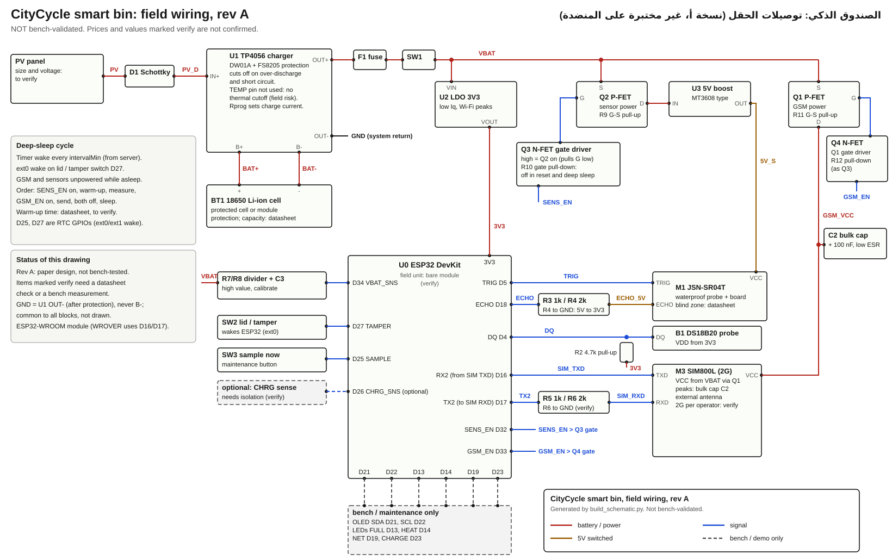

# CityFix / CityCycle — Technical Documentation

**SolveThe17 · Track 4: Unlocking Egypt’s Waste Economy**

Submission snapshot: 2026-10-23. Software proof of concept with simulated hardware.

## 1. Purpose, users and honest scope

CityCycle connects households offering sorted recyclables, informal collectors carrying out pickups, and district staff coordinating service. It adds waste recovery workflows to the CityFix citizen mobile app, citizen website and Command Center. The theme cites approximately 20 million tonnes of municipal solid waste annually in Egypt and recovery of up to 80% of the waste gathered by the Zabbaleen. The 80% figure is not Egypt's national recycling rate; these are challenge-provided facts, not our pilot results.

The implemented software includes pickup requests, collector acceptance, recorded material weights and cash amounts, household confirmation, bin telemetry ingestion, history and alerts. AI suggests; a person confirms. A deterministic fallback is not evidence of a successful Gemini call. Maps access does not establish backend access.

The PC simulator is operational locally; Wokwi bin and scale source and native logic tests are available. The physical solar/GSM bin is a paper design. No bench unit, physical scale accuracy, battery life or field deployment is claimed.

**Proposed idea, not implemented acceptance:** recycler handover receipts, confirmed recovery rather than collection alone, collector net earnings after costs, authenticated scale-to-pickup verification and weight/payment dispute handling. These extend the pitch and pilot plan; they are not features added by this documentation package.

## 2. System architecture



The diagram describes implementation boundaries; hosting/database labels marked “to verify” are not deployment certifications. Team-provided web/API addresses and APK build are listed in the package index.

| Component | Responsibility | Boundary / limitation |
| --- | --- | --- |
| Expo mobile (`apps/mobile`) | Citizen and collector UI, maps, persistent queues | Mock by default in source; backend-linked preview build explicitly uses API mode. Native Maps configuration is separate from API configuration. |
| Citizen web (`apps/web`) | Household reporting, recyclables requests and tracking | Public browser smart-bin demo never writes to the API. |
| Command Center (`apps/admin-web`) | Staff pickup, bin, alert, payout and planning views | Requires backend URL and staff authorization. |
| FastAPI (`backend`) | Authentication, role checks, workflows, device ingestion, AI adapters | SQLAlchemy; local SQLite demo, PostgreSQL migration path. Live database state not certified. |
| CityBrain | Consented waste/photo suggestions, transcription adapters and fallback | Server-side Gemini key required for Gemini; live quality evaluation is still pending. |
| Hardware models | PC telemetry simulator, Wokwi ESP32 bin and hub scale | Scale delivery is local mock; no physical build. |

Detailed architecture and API shapes: [architecture](../../docs/architecture.md), [API contract](../../docs/api-contract.md), [AI status](../../docs/ai-status.md).

## 3. Process flowcharts

### Household / collector workflow

```text
Household selects materials, location and pickup time
                         ↓
Backend stores request and price-list estimate (if prices exist)
                         ↓
Verified collector accepts → second acceptance is rejected
                         ↓
Collector records each material's weight and cash amount
                         ↓
Collector completes → household confirms → recorded impact
                         ↓
[PROPOSED] Recycler records accepted/rejected material and receipt
                         ↓
[PROPOSED] Confirmed recovery and collector net-earnings reporting
```

Collected kilograms are not proof of recycling. A recorded material value is not profit. A weighing labelled “scale” is not sufficient evidence of a calibrated, authenticated device measurement.

### Smart-bin telemetry workflow

```text
Sample fill distance / temperature / synthetic battery
                         ↓
Validate sensors → invalid reading: show fault, do not invent data
                         ↓
Queue immutable reading with increasing sequence number
                         ↓
Offline / failed send? → retain reading and retry with backoff
                         ↓
Receiver authenticates device key and de-duplicates (bin ID, seq)
                         ↓
202 + accepted sequence IDs → remove acknowledged rows only
                         ↓
Backend latest state/history → Command Center and citizen bin layer
```

The PC simulator can target the real API. Wokwi defaults to local mock; optional bin HTTP needs explicit endpoint/key/TLS configuration. Wokwi scale HTTP is not implemented. These are separate demonstrations, not an automatic connected chain.

## 4. Device contract and security

`POST /iot/bins/{id}/readings` uses `X-Device-Key`, a batch of readings and a `202` acknowledgement. Example values are illustrative:

```json
{"readings":[{"seq":1042,"at":null,"fillPct":82,"distanceCm":22,
"tempC":38.5,"batteryV":3.91,"rssi":-85,"fw":"sim-0.1.0"}]}
```

```json
{"accepted":[1042],"intervalMin":30,"fullPct":80,"heatC":60}
```

An unknown clock is stamped by the receiver and marked unsynced. Duplicate identical sequences are safe; conflicting reuse is rejected. Policies change only after a valid acknowledgement. Device registry/rotation, staff roles and citizen tokens are separate identities; keys must never appear in screenshots or committed files.

`POST /iot/hubs/{id}/weighings` exists in the backend and acknowledges a sequence. The Wokwi scale has a persistent local queue but does not send HTTP. Connecting this measurement reliably to a collector pickup remains integration work. Cash is recorded, not electronically transferred.

Citizen photos need consent for model analysis and private upload configuration. Gemini credentials belong on the server. Exact household locations and collector financial records need role-restricted access. Retry/idempotency and offline queues reduce duplicate writes; they do not establish delivery without an acknowledgement.

## 5. Circuit and field design



The separately supplied **CityFix-Circuit-Diagram.pdf** provides a larger A3 view. The SVG and generated pin table are in [schematics](../../hardware/schematics/README.md).

| Block | Proposed field component | Engineering requirement still to validate |
| --- | --- | --- |
| Controller | ESP32 | Real deep-sleep firmware and measured whole-board sleep current |
| Fill | Waterproof JSN-SR04T or suitable alternative | Mounting blind zone, per-bin calibration, voltage levels and contamination |
| Temperature | Waterproof DS18B20 | Placement and response time; bin temperature is not battery thermal protection |
| Street connectivity | SIM800L, subject to 2G availability; LTE alternative | Operator service, modem current peaks, external antenna and TLS capability |
| Power | Solar, protected 18650 cell, charger, fuse and regulator | Solar sizing, cell charge-temperature cutoff, safe power path and discharge test |
| Enclosure | Gasketed enclosure, glands, mounting and security screws | Assembled dust, splash, heat and maintenance tests; no verified IP rating claimed |
| Optional hub scale | Load cell + HX711 + ESP32 | Calibration, stability, payload range and trusted backend/phone handover |

The Wokwi battery potentiometer and solar switch are synthetic controls, not an energy model. A real battery needs a divider; a 5 V sensor echo must not go directly to the ESP32. The design notes identify a charger without thermal cutoff and unverified solar-input compatibility: component substitution and bench validation are gates before a physical deployment.

## 6. Estimated Bill of Materials in EGP

Use [CityFix-BOM-Estimate.csv](CityFix-BOM-Estimate.csv) with [COST-ESTIMATE.md](COST-ESTIMATE.md). The budget is based on dated Egyptian supplier prices, with item quantities and source links. Prices verify a budget input, not suitability of the circuit. One custom mounting row still needs a workshop quote; it is not silently counted as free.

Totals are generated into the cost report. They separate the priced smart-bin component subtotal, monthly connectivity reference and optional scale component subset. Existing computer/phone/bin assets, labour, collection vehicles, installation, cloud/provider usage and taxes/delivery not included by a supplier require separate budgets. Replacing 2G or the charger/power design can materially change cost.

## 7. Prototype evidence and reproduction

The [prototype runbook](PROTOTYPE-RUNBOOK.md) provides a dependency-free PC demonstration and a full local software setup. The [verification record](VERIFICATION.md) records the commands actually executed for this package and distinguishes tests from live service verification.

The local simulator tests cover queue persistence, retry handling, receiver behaviour and controls. Native C++ tests cover bin and scale logic. Backend integration tests exercise authenticated bin registration/ingestion/history and collector workflows using a test database, not the hosted database.

The team supplied hosted addresses for all three web services and reported Maps working on an Android APK. Workspace network policy prevented independent live verification. Gemini requires a valid server-side key and supported media path; accuracy, production provider configuration and live OTP must be checked separately. No database migration or production data write was performed for this package.

## 8. Egyptian deployment and evaluation

Submit the separate two-page **CityFix-Field-Deployment-Brief.pdf**. It covers heat, dust, street washing, weak networks, power, vandalism, low literacy, worker participation, maintenance and pilot gates.

Start with one neighbourhood, participating collectors, a hub and a recycler. Retrofit existing assets where useful. Measure collection time, overflow duration, contamination and cost per collected kilogram. Confirmed recycler recovery and collector net earnings require the proposed receipt/cost tracking, not current collection totals. Set numerical success targets with partners after a baseline; no unmeasured benefit, accuracy, payback or emissions saving is claimed.

References: [challenge framing](../../docs/vision.md), [claims and evidence](../../docs/evidence.md), [field engineering](../../hardware/README.md), [dated supplier evidence](../../hardware/bom/bom.csv), [power formulas](../../hardware/power/README.md), [presentation](CityFix-Pitch-Deck.pdf).
