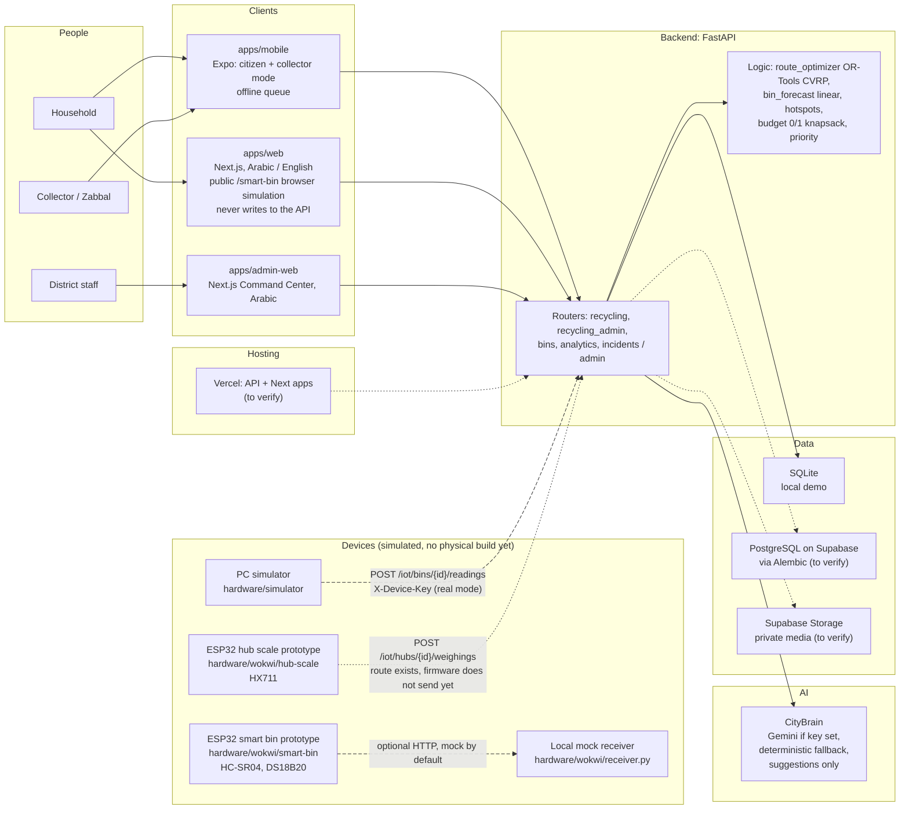

# Architecture

How CityCycle fits into CityFix: who uses what, which parts talk to the one backend, and which parts are implemented, simulated or still to verify. For the product picture see [vision.md](vision.md); for the API shapes see [api-contract.md](api-contract.md).

## System diagram

Legend: solid arrow = implemented and covered by tests; dashed = simulated or prototype only; dotted = planned or to verify.

The SVG above is the checked-in export of this Mermaid source.

### Regenerating

The SVG mirrors the Mermaid node list one to one (same groups, same node names, same edges). When one changes, edit both in the same commit. The SVG is hand-written and has no dependencies (rectangles, lines, paths and text only), so it renders anywhere GitHub shows images. For a PNG, open the SVG in a browser and take a 2x screenshot; optionally run `npx -y @mermaid-js/mermaid-cli` once to compare against the Mermaid source.

## Data flow: smart bin to alert to route

1. **Sensor to reading.** The prototype firmware takes five distance samples, keeps the median, converts it to `fillPct` and stores the reading in a sequence-numbered buffer (`hardware/wokwi/README.md`).
2. **Device to API.** `POST /iot/bins/{binId}/readings` with header `X-Device-Key` accepts up to 50 readings. The pair `(binId, seq)` is unique, so an identical retry is acknowledged and a conflicting one returns `409`. A reading with `at: null` is stored with `clockUnsynced` true and stamped with the arrival time.
3. **Server decides the state.** A reading is full when `fillPct` is at or above the bin's `full_pct` (default 80) and hot when `tempC` is at or above `heat_c` (default 60) (`backend/app/models.py`). Both defaults are illustrative and need to be agreed with the district (to verify).
4. **Command Center and citizens.** `GET /admin/bins` feeds the Command Center bins page and map; `GET /bins` feeds the citizen map layer, where a full bin has state `full`. A citizen can call `POST /bins/{id}/report-full`, which creates a FixFirst `garbage` incident linked to the bin.
5. **Forecast.** `GET /admin/bins/forecast` returns `hoursToFull` from a linear fit, only when the bin has at least 3 clock-synced readings spanning at least one hour and its latest reading is recent. Otherwise the reason is `insufficient_data` or `stale`. The seed bins `BIN-012` and `BIN-014` carry synthetic history so the demo shows a forecast; the other seed bins do not.
6. **Route.** `POST /admin/recycling/routes/optimize` takes `pickupIds`, `depot`, `vehicleCount` and `capacityKg` and returns ordered stops per vehicle from an OR-Tools capacitated routing model. It is an admin-only preview: nothing is saved or dispatched, and it answers `503` if OR-Tools is not installed.

Bins are not yet stops in the optimizer. Today it routes recyclables pickup requests only; routing full bins is future work.

## Data flow: collector payment

1. **Request.** A household calls `POST /recycling/pickups`; the estimate comes from the district price list (`GET /recycling/materials`). Materials without a price get no estimate.
2. **Verification.** A collector applies with `POST /collectors/apply`; an admin verifies them with `PATCH /admin/collectors/{id}`.
3. **Accept.** The collector lists nearby jobs with `GET /collector/jobs` (approximate pin only) and takes one with `POST /collector/jobs/{id}/accept`. The first accept wins; a second collector gets `409`.
4. **Weigh.** `POST /collector/jobs/{id}/weighings` records kg and a source (`manual`, `scale_ble` or `scale_api`). A client id makes retries idempotent, and the district price per kg in force is stored with each weighing.
5. **Complete.** `POST /collector/jobs/{id}/complete` closes the job and records the amount paid to the household.
6. **Confirm.** The household confirms the weight with `POST /recycling/pickups/{id}/confirm`.
7. **Results.** The numbers appear in `GET /me/impact`, `GET /collector/earnings`, `GET /admin/payouts` and `GET /admin/recycling/summary`.

Amounts are recorded only. No payment provider is integrated and no money moves through the platform.

## Where to read more

- [API contract](api-contract.md) and [hardware and IoT brief](team/hardware-iot.md)
- [Wokwi ESP32 prototypes](../hardware/wokwi/README.md) and [PC simulator](../hardware/simulator/README.md)
- [Claims vs evidence](evidence.md)
- Schematics: `hardware/schematics/` (added in a parallel PR)
