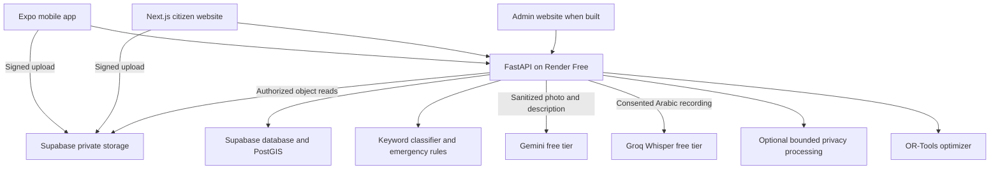

# CityBrain Free Hosted Implementation Plan

> **For agentic workers:** Use `superpowers:executing-plans` to implement this plan task by task. Steps use checkboxes for tracking. This document is a plan, not an implemented or deployed service.

**Goal:** Deliver CityFix's photo/text triage, Egyptian Arabic transcription, optional OCR, privacy processing, and budget optimization with everything hosted online and no paid services.

**Architecture:** Both clients call the same FastAPI backend on Render Free. The backend calls free inference APIs, stores durable data and uploads in Supabase Free, and returns a deterministic keyword fallback when triage inference is unavailable. Large open-weight models are an optional alternative on an eligible Hugging Face ZeroGPU Space, not a dependency of the initial deployment.

**Tech stack:** Python 3.12, FastAPI, Pydantic, async HTTP client, Pillow, OpenCV headless, optional ONNX Runtime, OR-Tools, Gemini Developer API, Groq Whisper, existing Expo and Next.js clients.

**Spec:** `docs/team/ai-features.md`, `docs/api-contract.md`, and the user's additional constraints: all hosting online; no paid inference, subscriptions, rented GPUs, or expiring credits. This plan proposes replacing the brief's paid LLM example with a free-tier provider. OCR is an optional addition, not an existing repo requirement.

## Scope and feasibility

- A small online demo can have a $0 service bill within free quotas. Unlimited inference, guaranteed uptime, and guaranteed cold-start latency cannot be promised for $0.
- No local computer or tunnel is required by the recommended design.
- The checked-out repository has client API adapters and mocks, but no `backend/` implementation. Member 4 must supply the API/auth/upload/database foundation; implementing only AI functions does not create a working full application.
- Suggested schedule: seven working days for the core features, assuming Member 4 works concurrently. OCR, automated privacy deployment, and similarity ranking have separate acceptance gates; extend the schedule if model evaluation or backend integration takes longer.
- No training is required for the first version. Evaluate pretrained models on local examples before choosing fine-tuning.

## Global constraints

- Python 3.12; validate all model output with Pydantic and the repo's 12 category IDs.
- AI results are suggestions a human confirms; never automatically merge reports or change an incident's priority.
- `/triage` has a 4-second internal deadline and a target warm-server p95 below 5 seconds, including keyword fallback. Uploads and transcription are measured separately.
- A cold/sleeping hosting service cannot meet this deadline. Clients must also have a timeout and local fallback.
- One generative inference request per triage; retries disabled. Quota exhaustion, malformed responses, safety refusals, and timeouts use keyword fallback.
- Image long side at most 1600 px; maximum uploaded photo 5 MB; maximum voice note 30 seconds and 5 MB, enforced on the server as proposed demo limits.
- Provider keys and Supabase privileged keys are server-only. Public frontend environment variables contain only public configuration.
- Keep originals private; public image reads must resolve only approved redacted derivatives. Failed redaction shows a placeholder.
- Use consented, non-sensitive demonstration data. Google's free tier can use submitted content to improve products; do not submit confidential citizen information.
- Do not enable paid billing, paid fallback models, autoscaling, or additional paid services. Stop AI calls when the free allowance is exhausted.
- Coordinate schema, uploads, and base API changes with Member 4, and client changes with Members 1–3, following the repo's ownership rules.

## Hosting and cost decisions

| Component | Recommended deployment | Free boundary |
| --- | --- | --- |
| Main API and AI routers | Render Free web service | 512 MB RAM, limited shared CPU, idle sleep after 15 minutes; wake-up may take about a minute |
| Photo/text model and optional OCR | Gemini Developer API free tier | Quotas depend on account/model/project; record actual dashboard limits before rollout |
| Egyptian Arabic speech recognition | Groq Free, `whisper-large-v3-turbo` | Published free limits currently include 20 requests/min, 2,000/day, 7,200 audio sec/hour, 28,800/day; all limits apply together and account limits take precedence |
| Database and private uploads | Supabase Free, owned by Member 4 | Currently 500 MB database, 1 GB files, 5 GB egress, project pause after one week of inactivity |
| Citizen website | Vercel Hobby for an eligible personal non-commercial demo | Usage caps and personal/non-commercial terms; use an appropriate alternative if the project is not eligible |
| Mobile client | Existing Expo app in Expo Go for the demo | AI runs remotely; app store registration/distribution costs are outside the AI deployment |
| Optional model hosting | Hugging Face ZeroGPU Gradio Space | Free personal account must be in good standing, email verified, and older than 30 days; up to two Spaces; shared GPU queues and daily usage quotas |

Sources checked 2026-10-22: [Render Free](https://render.com/docs/free), [Render compute](https://render.com/docs/compute-plans), [Gemini pricing](https://ai.google.dev/gemini-api/docs/pricing), [Groq limits](https://console.groq.com/docs/rate-limits), [Supabase pricing](https://supabase.com/pricing), [Vercel Hobby](https://vercel.com/docs/plans/hobby), [ZeroGPU](https://huggingface.co/docs/hub/spaces-zerogpu).

Do not use Render Free to load PyTorch, Whisper, SigLIP, and PaddleOCR together. They do not fit this deployment's resource budget. Do not choose Render's free Postgres for durable project storage: its free database has a limited lifetime. Supabase is the repo's intended database service.

## Pretrained models

| Purpose | First deployment | Open-weight alternative | Decision / limitation |
| --- | --- | --- | --- |
| Photo + Egyptian Arabic classification, severity, summary | `gemini-3.5-flash-lite`, accessed through Gemini's free API | `google/siglip-base-patch16-224` (Apache-2.0) | Gemini supplies structured multimodal suggestions. SigLIP supplies image/text matching scores, not Arabic reasoning or a generated summary; use English image prompts and deterministic Arabic templates with it. Neither is a validated civic severity model. |
| Voice transcription | Groq `whisper-large-v3-turbo` | `Systran/faster-whisper-small` (MIT), CPU int8, or multilingual Whisper base for less memory | Set language to Arabic (`ar`), transcribe rather than translate; benchmark Egyptian dialect, street names, and noisy roads. Never use an English-only `.en` checkpoint. |
| Text in photos, optional | Extract visible Arabic/English text in the same Gemini triage call | PaddleOCR `PP-OCRv5_mobile_det` + `arabic_PP-OCRv5_mobile_rec` | OCR is separate from speech recognition. PaddleOCR offers Apache-2.0 tooling and multilingual checkpoints; pin the selected weight revisions and bundled notices. No PDF/document pipeline is needed for the current product. |
| Face locations for redaction | OpenCV Zoo YuNet (MIT) | Same model via ONNX | Detect boxes, expand them, and apply strong blur/pixelation. Match ONNX artifact to the pinned OpenCV runtime; current and older YuNet exports have different compatibility requirements. |
| License plate locations | Evaluate `faisalthaheem/open-lpr-models` / `plate_yolox_tiny_640.onnx` (publisher states Apache-2.0 for detector weights) | `Topurrra/rtdetr-license-plate-detection-onnx` (publisher labels Apache-2.0) | These are community checkpoints, not demonstrated Egyptian-plate solutions. Evaluate recall on Egyptian plates and memory on the deployment. Only detection is needed, not reading plate numbers. |
| Similar Arabic reports, stretch | Start with normalized Arabic text matching and existing geo filtering | `sentence-transformers/paraphrase-multilingual-MiniLM-L12-v2` (Apache-2.0) | Embeddings improve semantic ranking but require a suitable inference host. They do not replace the 250 m/category/open-status rule. |
| Budget planning | OR-Tools 0/1 knapsack | No pretrained model needed | Use confirmed deterministic priority and costs in integer piastres. |
| Weekly insights, stretch | SQL aggregates plus short Arabic templates | Optional Gemini phrasing of aggregate data only | Exact counts come from the database, never invented by the language model. |

Primary sources: [Gemini pricing](https://ai.google.dev/gemini-api/docs/pricing), [Gemini model lifecycle](https://ai.google.dev/gemini-api/docs/deprecations), [SigLIP model card](https://huggingface.co/google/siglip-base-patch16-224), [Groq speech API](https://console.groq.com/docs/speech-to-text), [Whisper small](https://huggingface.co/Systran/faster-whisper-small), [faster-whisper](https://github.com/SYSTRAN/faster-whisper), [PaddleOCR multilingual](https://www.paddleocr.ai/latest/en/version3.x/algorithm/PP-OCRv5/PP-OCRv5_multi_languages.html), [YuNet](https://github.com/opencv/opencv_zoo/blob/main/models/face_detection_yunet/README.md), [plate detector provenance](https://huggingface.co/faisalthaheem/open-lpr-models/blob/main/README.md), [RT-DETR plate candidate](https://huggingface.co/Topurrra/rtdetr-license-plate-detection-onnx), [multilingual MiniLM](https://huggingface.co/sentence-transformers/paraphrase-multilingual-MiniLM-L12-v2).

Model availability is a launch check, not an assumption: make one sanitized image/text request and one Arabic recording request using the actual free accounts. If the configured model has no free quota, keep fallback active and choose another explicitly free model after evaluation. Never silently switch to a paid endpoint. Gemini is a pretrained hosted model, not downloadable open weights.

## Architecture and data flow



The clients never call Gemini, Groq, or a public model Space directly. All inference goes through authenticated server routes. The backend derives the user from the token, checks ownership of each upload path, and reads objects from the configured bucket; it never fetches a client-supplied arbitrary URL.

Photo flow: sign upload → upload privately → request triage with the storage path → validate/sanitize input → classify or fall back → query nearby incidents → display an editable suggestion → submit the confirmed report. This upload-before-triage ordering must be checked in both report forms; the existing triage API adapter forwards `photoUri` unchanged.

Audio flow: record → private upload → `POST /ai/transcribe` with `{path}` → editable text → triage → report submission. A failed transcript must not discard the uploaded recording or block manual typing. The existing `uploadAndTranscribeVoiceNote` helper already supports that behavior.

## API and contract decisions

Keep current field names; do not substitute Python snake_case in JSON:

- `POST /triage`: `{description, categoryId?, photoUri?, location?: {lat, lng}}` → `{options, severity, summary, duplicates, alreadyReported?, source, emergency?}`.
- `POST /ai/transcribe`: `{path}` → `{text, language: "ar-EG", confidence: null}` initially. Whisper does not supply a calibrated probability of transcript correctness. Propose making `confidence` nullable in the contract and both clients' `Transcript` types; do not return a made-up `0.8`. `language` describes the configured demo use, not proof that dialect was detected.
- `POST /admin/budget/optimize`: preserve the current contract's `budgetEgp`, `incidentIds`, `selected`, `skipped`, `totalCost`, `remaining`, `coveredPriority` names; define item/reason shapes with the admin owner.
- OCR extension, optional: add `extractedText?: string` to `TriageSuggestion` through a contract PR. Extract it in the same model request. Display it separately for editing; never silently replace the description. Empty/uncertain text stays empty.
- Similarity and insights endpoints remain stretch proposals from the brief.
- New demo limits, nullable transcription confidence, and source/emergency fields require agreement with affected owners before relying on them.
- The existing clients send `Accept-Language`. Respect Arabic/English display preferences while transcribing original speech faithfully; the Arabic summary required by the brief remains the baseline.

## File map and ownership

| Path | Responsibility |
| --- | --- |
| `backend/app/ai/schemas.py` | Strict triage/transcript/OCR data models and enums |
| `backend/app/ai/keywords.py` | Port current Arabic and English keyword and emergency behavior |
| `backend/app/ai/llm.py` | Async Gemini adapter; timeout, no retries, structured output |
| `backend/app/ai/triage.py` | Orchestration, deadline, fallback, query hooks, audit metadata |
| `backend/app/ai/prompts/triage.md` | 12 categories, Egyptian examples, untrusted-input instructions |
| `backend/app/ai/transcribe.py` | Groq audio adapter, size/duration validation, cleanup |
| `backend/app/ai/blur.py` | Redacted derivative creation and detector adapters |
| `backend/app/ai/runtime.py` | Bounded processing, concurrency, feature flags, memory gates |
| `backend/app/ai/insights.py` | Optional aggregate-to-template summary |
| `backend/app/ai/similarity.py` | Optional candidate ranking |
| `backend/app/optimizer/knapsack.py` | Deterministic budget allocation |
| `backend/app/routers/{triage,ai,budget}.py` | Authenticated routes registered in Member 4's app |
| `backend/tests/test_ai_*.py`, `backend/tests/test_budget.py` | Unit and route tests with fake providers and query adapters |
| `backend/ai-eval/{dataset,run_eval.py,README.md}` | Consented examples, reproducible quality/latency results |
| `backend/{requirements.txt,.env.example,Dockerfile,README.md}` | Member 4 coordinates dependencies, configuration, deploy instructions |
| `render.yaml` | Member 4's explicit Free web service configuration |
| `docs/api-contract.md` | Agreed interface proposals |
| `apps/{mobile,web}/src/services/api/{index,http}.ts` | Existing network adapters; request cancellation/deadlines |
| `apps/{mobile,web}/src/domain/types.ts` | Coordinated optional OCR/nullable confidence changes |
| `apps/{mobile,web}/src/store/actions.ts` | Upload reuse and transcript workflow |

Do not build a second unrelated API just for AI. Until backend query hooks exist, inject a fake query adapter using the repo seed; switch to Member 4's `find_nearby_incidents`, category, budget-list, and suggestion-log functions at integration time.

## Review focus

1. Sleeping server or exhausted quota: report creation remains usable and manual entry is available.
2. Someone else's upload path: access is denied before any provider call.
3. Egyptian Arabic emergency wording or an unrelated photo: emergency rules remain active and unsupported visual certainty is avoided.
4. Late transcript or suggestion: it must not overwrite text/category the citizen has edited since starting the request.
5. Redaction misses a face or Egyptian plate: an unreviewed original never becomes publicly visible.

## Implementation tasks

### Task 1 — Working fallback endpoint and backend seam (Day 1)

**Files:** create `ai/schemas.py`, `ai/keywords.py`, `routers/triage.py`, `backend/tests/test_ai_keywords.py`, `backend/tests/test_ai_routes.py`; coordinate `main.py`, dependency lock, auth, and query hooks with Member 4.

**Interfaces:** `classify_keywords(description: str, category_hint: str | None) -> TriageSuggestion`; authenticated route consumes the contract body and query adapter, returns the contract shape.

- [ ] Port test fixtures from `apps/mobile/src/logic/__tests__/triage-mock.test.ts` and `emergency.test.ts`; assert Arabic/English categories, Arabic normalization, emergency flag, sorted top three, total confidence ≤ 1, and danger severity floors.
- [ ] Run `cd backend && python -m pytest tests/test_ai_keywords.py tests/test_ai_routes.py -q`; confirm initial failures identify missing behavior.
- [ ] Port the current classifier, including English support added since the role brief. Match the TypeScript algorithm; emit `source="fallback"`.
- [ ] Add route tests for unauthorized callers, forbidden object paths, own/followed duplicate exclusion, and an empty photo-only description with a category hint. A photo-only fallback must signal uncertainty rather than claim it inspected the image.
- [ ] Verify the same command passes with fake queries; commit this independently usable fallback endpoint.

### Task 2 — Evaluation baseline and free-account readiness (Day 1–2)

**Files:** create `backend/ai-eval/dataset/manifest.jsonl`, `run_eval.py`, `README.md`; update backend configuration examples.

- [ ] Gather at least 60 consented photo/text examples spanning all 12 categories (minimum brief requirement is 30); assign 36 for development and 24 held out for reporting. Keep similar/duplicate photos in the same split. These are smoke-scale results, not production validation.
- [ ] Add 10 real Egyptian Arabic recordings with human transcripts, including street noise and street names; compare Whisper turbo and large-v3 if both have free allowance. Keep names/phone numbers out of demo recordings.
- [ ] Record top-1/top-3 accuracy, per-category errors, severity agreement, warm p50/p95, cold-start delay, and fallback rate. Use a fixed Arabic normalization policy for WER/CER.
- [ ] Verify actual Gemini/Groq free access with sanitized samples; record model IDs, account limits, and date, without storing keys or private account identifiers.
- [ ] Run `cd backend && python ai-eval/run_eval.py --mode keywords`; save measured baseline results and commit evaluation tooling/data with consent metadata. Do not prefill accuracy numbers.

### Task 3 — Photo/text model integration (Day 2–3)

**Files:** create `ai/llm.py`, `ai/triage.py`, `ai/prompts/triage.md`, `backend/tests/test_ai_triage.py`; connect the fallback route.

**Interfaces:** `analyze_report(description: str, photo_path: str | None, category_hint: str | None, location: Location | None, user_id: str) -> TriageSuggestion`; `GeminiClient.suggest(...) -> ModelSuggestion` is an injectable async provider boundary.

- [ ] Write tests with fake provider responses for correct output, invalid category, NaN/out-of-range confidence, sum > 1, safety refusal, 429, model not available, malformed JSON, provider timeout, and adversarial instructions embedded in description or image text.
- [ ] Run `python -m pytest tests/test_ai_triage.py -q` from `backend`; confirm failures before implementing the adapter.
- [ ] Configure `GEMINI_MODEL=gemini-3.5-flash-lite`, strict JSON schema, short one-line summary, capped output, no tools/search, and the lowest supported reasoning setting. Benchmark rather than assume speed.
- [ ] Run emergency keyword checks independently of the provider; provider output cannot suppress an emergency flag. If the provider also identifies an emergency, validate and preserve the more cautious result.
- [ ] Use one 4-second orchestration deadline covering object retrieval, inference, validation, and duplicate queries. Bound database calls; a failed duplicate lookup returns empty suggestions and an internal log entry, never fabricated incidents.
- [ ] Enforce authenticated demo allowance of 10 triage requests/minute and 50/day per user plus a global provider allowance configured from actual account quotas. Return fallback when the model allowance is spent; retain normal auth/validation errors.
- [ ] Record source/model/version/latency/fallback reason through Member 4's logging seam. Treat confidence as an uncalibrated model estimate; do not label it measured accuracy.
- [ ] Verify tests pass, then run `python ai-eval/run_eval.py --mode hosted`; compare against baseline and inspect failures before enabling the model. Commit.

### Task 4 — Voice transcription (Day 3)

**Files:** create `ai/transcribe.py`, `routers/ai.py`, `backend/tests/test_ai_transcribe.py`; coordinate nullable confidence contract/client types.

**Interface:** `transcribe(path: str, user_id: str) -> TranscriptResponse` with `text`, `language`, and nullable `confidence`.

- [ ] Write tests asserting no provider call for another user's path, oversized or >30-second audio, invalid file content, and silence; provider 429/timeout returns a typed error and preserves the stored recording.
- [ ] Run `python -m pytest tests/test_ai_transcribe.py -q` from `backend`; confirm expected failures.
- [ ] Send audio bytes from private storage to Groq's transcription endpoint using `whisper-large-v3-turbo`, Arabic language, and no translation. Cap provider work at 20 seconds and one request; do not manufacture confidence from language probability.
- [ ] Support the existing recorder MIME formats from the contract; validate decoded duration, not merely extension. Use bounded ffprobe/FFmpeg if needed, with argument arrays and temporary files, not shell interpolation.
- [ ] Enforce 5 transcription requests/minute and 20/day per demo user, plus the actual organization audio quota. Delete temporary decoded files immediately; persistent raw audio follows a documented retention rule coordinated with Member 4 (demo proposal: 24 hours).
- [ ] Verify tests and run the 10-recording benchmark; publish WER/CER and latency, and choose turbo versus large-v3 by observed results. Commit.

### Task 5 — Optional OCR without another triage call (Day 4)

**Files:** update `ai/schemas.py`, prompt, both clients' domain types and report suggestion UI; create `backend/tests/test_ai_ocr.py`.

- [ ] Agree `extractedText?: string` through the API contract and add tests: no visible text → empty; legible Arabic/English signs → faithful text; uncertain letters → no invented completion; prompt-like text is data.
- [ ] Return optional OCR from the same Gemini call used for classification. Keep it separate from the citizen's description and allow a deliberate user action to insert/edit it.
- [ ] Redact identifiers before transmitting images. Do not extract plate numbers or identity-document information into logs or public summaries.
- [ ] Verify tests and inspect at least 20 consented sign/text photos. Do not claim OCR completion if it is only returning mock text. Commit separately so the core triage can ship without it.

### Task 6 — Budget optimizer (Day 4)

**Files:** create `optimizer/knapsack.py`, `routers/budget.py`, `backend/tests/test_budget.py`.

**Interface:** `optimize(budget_egp: Decimal, incidents: list[BudgetIncident]) -> BudgetPlan`; incidents contain ID, confirmed integer priority, and validated estimated cost. Output matches the agreed API item shapes.

- [ ] Write tests for zero budget, exact fit, no affordable items, duplicate IDs, invalid/negative/missing costs, unknown requested IDs, admin authorization, and repeatability. Assert `totalCost <= budgetEgp`, no duplicate selection, and selected + skipped account for all eligible candidates.
- [ ] Run `python -m pytest tests/test_budget.py -q` from `backend`; confirm failures.
- [ ] Implement 0/1 knapsack with OR-Tools using integer piastres. Cap the demo at 100 eligible incidents; use one solver worker and deterministic ID tie-breaking. Use a fixed search budget and report feasibility rather than claim proven optimality when search stops early.
- [ ] Construct one-line Arabic explanations from cost/priority facts. Unknown cost means skipped with a reason, never free. Read incidents through Member 4's budget query, not direct AI SQL.
- [ ] Verify tests and peak memory when OR-Tools and privacy dependencies are loaded; commit.

### Task 7 — Privacy derivatives with a deployment gate (Day 4–5)

**Files:** create `ai/blur.py`, `ai/runtime.py`, `backend/tests/test_ai_blur.py`; coordinate Member 4's upload/object metadata and public image mapping.

**Interface:** `redact_image(input_path: Path, output_path: Path) -> RedactionResult` returns a distinct derivative and processing status; it never mutates the original. A processed derivative is still unapproved until review.

- [ ] Test output differs from original, EXIF/GPS metadata is removed, rotated images are handled, detector errors keep the photo private, and the public read route never signs an original path.
- [ ] Evaluate YuNet plus the plate-specific YOLOX-tiny ONNX checkpoint. Record pinned revisions, licenses, file hashes, and detector recall on consented Egyptian faces/plates; test small/angled plates and crowded scenes.
- [ ] Process one image at a time in a bounded worker outside the async event loop, with an empty or single-slot queue. Reject/defer excess work. An HTTP timeout alone does not stop CPU inference; keep the slot occupied until the work actually finishes or its process is terminated.
- [ ] Measure whole-process peak RSS below 400 MB on the 512 MB deployment, including API, buffers, solver, and runtime. Measure cold load as well as inference. This is a release gate, not an assumed property of ONNX models.
- [ ] If it does not fit or is too slow, keep the photos private and deploy privacy processing in an eligible ZeroGPU Space; otherwise require staff-provided redacted demo copies. Automatic privacy is incomplete until that worker is working. Never publish originals to make the demo appear complete.
- [ ] Require staff review of public derivatives for the demo. Only staff-approved non-sensitive images are eligible for the free Gemini image path; otherwise triage uses sanitized text until redaction/review finishes. This intentionally trades photo immediacy for the repo's privacy promise.
- [ ] Verify blur tests, memory measurements, and authorized public/private reads. Commit.

### Task 8 — Integrate both existing clients (Day 5)

**Files:** `apps/mobile/src/services/api/{index,http}.ts`, `apps/web/src/services/api/{index,http}.ts`, both `src/store/actions.ts`, report-form components, `src/domain/types.ts`, client tests and env examples.

- [ ] Add meaningful integration tests: selected photo is uploaded before triage; API receives a storage path; voice note uploads once; a late response does not overwrite edits; a 429/cold-start/network timeout still allows report submission.
- [ ] Reuse existing `services.triage.analyze`, `services.transcription.transcribe`, and `uploadAndTranscribeVoiceNote`; no new direct model SDK in the clients.
- [ ] Add request cancellation/timeouts in the existing HTTP helper: 6 seconds for triage, 25 seconds for transcription. These are client wait limits, not provider throughput promises. Use the existing local keyword classifier if triage cannot reach the server; do not invent duplicates on network failure.
- [ ] Show a clear editable suggestion, source/fallback state, emergency information first, and transcription loading/error/manual-entry states. Preserve citizen category choices until they explicitly accept a suggestion.
- [ ] Coordinate both shared copies and run each app's shared-code comparison script. Read the current Expo 57 docs before changing Expo APIs, per `apps/mobile/AGENTS.md`.
- [ ] Run web `npm test`, `npm run typecheck`, `npm run lint`, `npm run build`, and `npm run check:shared`; run mobile `npm test -- --runInBand`, `npx tsc --noEmit`, and `npx expo lint`. Use the installed package manager/lockfile and repository scripts if their commands differ.
- [ ] Exercise the actual API deployment from a physical phone and desktop browser, including upload CORS and an expired token. Commit client changes with their owners.

### Task 9 — Deploy fully online (Day 6)

**Files:** Member 4's `backend/requirements.txt`, `.env.example`, `README.md`, optional `Dockerfile`, root `render.yaml`; website env example.

- [ ] Use a development branch, pin tested dependency versions, and run backend unit tests with fake providers in CI. Do not consume external free quotas on every CI run; live smoke checks are explicit deployment checks.
- [ ] Create/use the project's Supabase Free database and private buckets through Member 4. Apply owner-scoped storage policies and RLS on exposed tables; signing must verify path ownership. Keep privileged credentials only on the backend. Enable exact website origins for browser uploads.
- [ ] Provision a Render **Free web service**, root directory `backend`, Python 3.12. Native build: `pip install -r requirements.txt`; start: `uvicorn app.main:app --host 0.0.0.0 --port $PORT --workers 1`. If ffprobe is required, use a Docker image with it installed; external `PORT` still determines the listener. This plan does not build or run that image yet.
- [ ] Configure server secrets `GEMINI_API_KEY`, `GROQ_API_KEY`, and Member 4's database/storage/auth settings. Configure `GEMINI_MODEL`, `STT_MODEL`, allowed CORS origins, and global quota ceilings. Do not print secrets in logs or health responses.
- [ ] Add `/health` for process liveness and `/ready` for DB/config readiness without spending an inference call on every probe. Readiness may indicate AI disabled while the keyword API is healthy.
- [ ] Deploy the existing Next.js citizen site with project root `apps/web` under an eligible free hosting plan. Set the public env variables below and rebuild. The admin website is not in this checkout; its owner adds the budget/similarity/insight consumers when built.
- [ ] Set the mobile public variables below; restart the Expo bundle or rebuild the distributed client so the URL is included. The mobile app itself runs on the phone; its API, data, and model computation are hosted online.
- [ ] Check backend health, one model-assisted triage, forced provider fallback, one real transcript, admin budget authorization, private original access rejection, and authorized derivative access from both clients.
- [ ] Leave the Render service idle long enough to sleep, measure wake-up, and verify client fallback and eventual recovery. Open the deployed application before a scheduled demo; do not use artificial keep-alive traffic as an assumed way around free-host limits.
- [ ] Document free quotas, dashboard locations, restore/reset procedure, and removal of temporary files. Keep paid billing disabled; demo auth must use a restricted server-side allowlist/test OTP or another agreed free flow. Real SMS/WhatsApp OTP delivery is a separate cost and is not made free by AI hosting.

Mobile configuration:

```dotenv
EXPO_PUBLIC_API_MODE=api
EXPO_PUBLIC_API_URL=https://YOUR-API.onrender.com
```

Citizen website configuration:

```dotenv
NEXT_PUBLIC_API_MODE=api
NEXT_PUBLIC_API_URL=https://YOUR-API.onrender.com
```

Setting these switches the **whole client** to real API mode. It requires real auth, reports, uploads, incidents, and services endpoints from Member 4, not just `/triage` and `/ai/transcribe`. Do not present an AI-only deployment as a fully integrated app.

### Task 10 — Evaluation, demo, and optional extensions (Day 7+)

- [ ] Run the held-out evaluation once after prompt/model decisions are frozen. Report category counts and errors, top-1/top-3, severity agreement, emergency cases, transcription WER/CER, warm p50/p95, cold start, fallbacks, and measured maximum memory. No target is a claimed result until measured.
- [ ] Minimum release gate: fallback tests pass; zero invalid category IDs; zero unauthorized object reads in tests; emergency regression fixtures pass; budget invariants pass; warm-server p95 below 5 seconds including fallback. Model-assisted outputs should beat the keyword baseline on the development set and be reported honestly on the small held-out set.
- [ ] Prepare three live demonstrations: pothole photo, Egyptian Arabic open-manhole recording, and nearby duplicate. Include a forced provider outage to demonstrate continued manual reporting.
- [ ] Add stretch features only after core acceptance: normalized text/photo similarity ranks backend candidates; a later eligible worker can serve MiniLM/SigLIP embeddings. Weekly insights start with authoritative counts and Arabic templates, with cached optional aggregate-only model phrasing.
- [ ] Record final deployed URLs, exact model versions, quota status, test commands/results, data consent, and known limitations in `backend/ai-eval/README.md` and `docs/progress-log.md`.

## Optional open-weight hosting path

If the team specifically wants to serve downloadable pretrained models, first verify an eligible free Hugging Face account can actually create a ZeroGPU Space. Create a **Gradio** Space, load pinned model weights, and wrap GPU work with the supported ZeroGPU decorator. Call its documented Gradio API from the backend with a server-side token; include a separate worker authentication check and do not expose private storage credentials. Send only authorized sanitized inputs.

Start with SigLIP for image matching and Whisper for transcription; add PaddleOCR and MiniLM only if quotas and memory allow. Use a shared queue and fallback when queue delay exceeds the triage deadline. Requests from the backend may share one account's GPU quota; do not assume every citizen receives a separate free allowance. A Space is ephemeral compute, not a database or durable audio store.

This path requires additional worker code and evaluation and may fail the five-second model-response goal under shared queues. Free ZeroGPU hosting is conditional; standard new Docker/Gradio CPU Spaces currently require a paid plan. Do not assume free weights imply free 24/7 GPU serving. See [Spaces overview](https://huggingface.co/docs/hub/en/spaces-overview) and [ZeroGPU](https://huggingface.co/docs/hub/spaces-zerogpu).

## Completion status

This document finishes the requested planning work. Implementation, external account provisioning, database changes, model benchmarks, client integration, and deployment have not been performed. The privacy worker's feasibility and actual free-account quotas remain explicit implementation gates.
